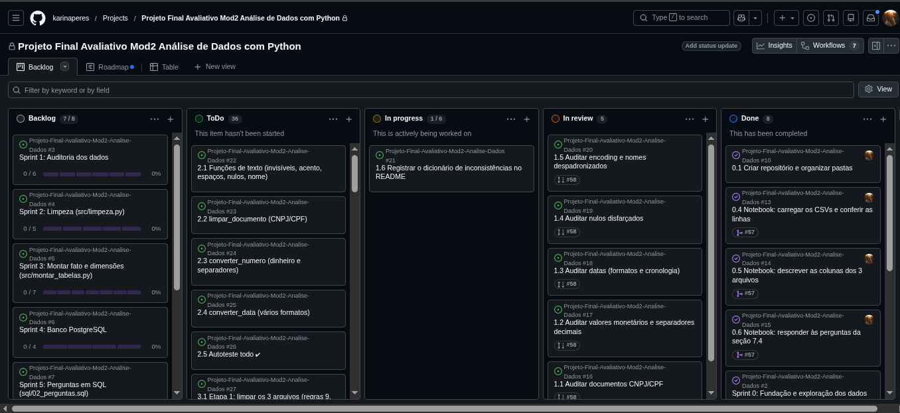
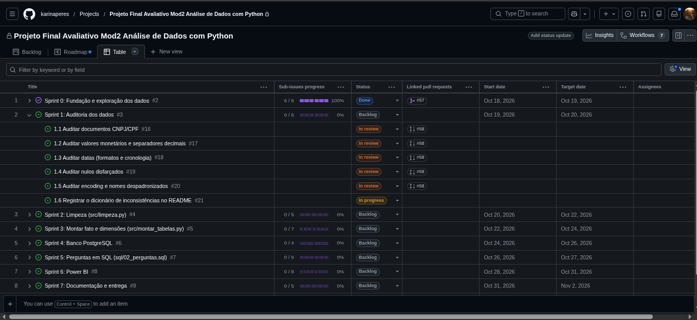
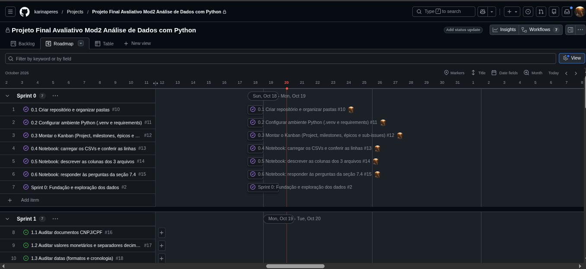
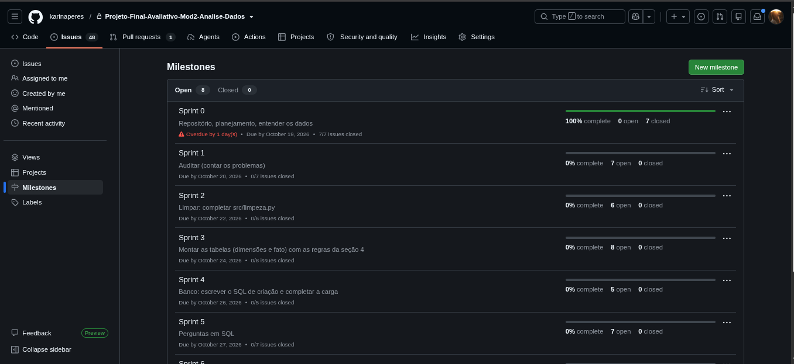

# Radar das Compras Públicas

Pipeline de dados de ponta a ponta com as contratações públicas federais de 2025 (PNCP): auditoria e limpeza em Python, modelo estrela no PostgreSQL e dashboard no Power BI para apoiar a Controladoria na análise de economia, concentração de fornecedores, eficiência das modalidades, tempo de ciclo, distribuição regional e perfil de gasto.

---

## Sumário

1. [Contexto](#1-contexto)
2. [Perguntas de negócio](#2-perguntas-de-negócio)
3. [Arquitetura](#3-arquitetura)
4. [Tecnologias](#4-tecnologias)
5. [Estrutura do repositório](#5-estrutura-do-repositório)
6. [Dados](#6-dados)
7. [Dicionário de inconsistências](#7-dicionário-de-inconsistências)
8. [Decisões técnicas e regras de negócio](#8-decisões-técnicas-e-regras-de-negócio)
9. [Modelagem dimensional](#9-modelagem-dimensional)
10. [Resultados](#10-resultados)
11. [Dashboard](#11-dashboard)
12. [Como executar](#12-como-executar)
13. [Planejamento em Sprints](#13-planejamento-em-sprints)
14. [Melhorias futuras](#14-melhorias-futuras)
15. [Vídeo](#15-vídeo)
16. [Autoria](#16-autoria)

---

## 1. Contexto

A Controladoria identificou gargalos nas compras públicas federais: indícios de sobrepreço em itens homologados, concentração de contratos em poucos fornecedores, demora entre a publicação dos editais e a homologação e baixa competição em algumas modalidades.

Os dados vêm de sistemas sem validação na entrada. O resultado é uma base com identificadores corrompidos, valores monetários em texto livre, datas em vários formatos, acentos quebrados e nulos disfarçados. Relatórios gerados direto desses dados não são confiáveis.

Este projeto constrói uma esteira analítica que transforma a base bruta em um ambiente auditável e em um dashboard executivo.

## 2. Perguntas de negócio

| # | Tema | Pergunta |
|---|---|---|
| 1 | Economia | Qual o percentual e o valor economizado entre o estimado e o homologado? |
| 2 | Fornecedores | Quem são os maiores fornecedores em volume e quanto do orçamento está concentrado neles? |
| 3 | Modalidades | Quais modalidades trazem maior economia e quais concentram mais recursos? |
| 4 | Ciclo | Qual a duração média entre a publicação do edital e a homologação, por órgão? |
| 5 | Regional | Quais estados e regiões concentram as maiores despesas e os melhores descontos? |
| 6 | Perfil | Como os recursos se distribuem entre bens, serviços e obras e engenharia? |

## 3. Arquitetura

```
PNCP (CSVs brutos)  →  Python (auditoria e limpeza)  →  PostgreSQL (modelo estrela)  →  Power BI (dashboard)
```

| Etapa | O que faz | Onde |
|---|---|---|
| Exploração e auditoria | Identifica e mede os problemas dos dados | `notebooks/` |
| Limpeza | Funções que corrigem cada tipo de problema | `src/limpeza.py` |
| Transformação | Aplica as regras de negócio e monta fato e dimensões | `src/montar_tabelas.py` |
| Carga | Cria o banco e carrega as tabelas em lote | `sql/01_criar_banco.sql`, `src/carregar.py` |
| Análise | Responde às 6 perguntas | `sql/02_perguntas.sql`, `powerbi/` |

## 4. Tecnologias

| Tecnologia | Uso |
|---|---|
| Python 3 + pandas | Auditoria, limpeza e transformação |
| Jupyter Notebook | Exploração e auditoria documentadas |
| PostgreSQL + psycopg2 | Banco analítico e carga |
| Power BI (DAX) | Dashboard, calendário e medidas |
| Git e GitHub (Projects, Issues, PRs) | Versionamento e gestão das Sprints |

## 5. Estrutura do repositório

```
├── data/
│   ├── raw/              # CSVs brutos do PNCP (fonte, não alterados)
│   └── processed/        # tabelas tratadas geradas pelo pipeline (fora do Git)
├── docs/                 # enunciado, tutorial e imagens do README
│   └── img/
├── notebooks/
│   ├── 01_exploracao.ipynb   # entendimento das colunas e das sujeiras
│   └── 02_auditoria.ipynb    # contagem de cada problema
├── src/                  # código do pipeline
├── .env.example          # modelo das credenciais do banco
└── requirements.txt      # dependências Python
```

*Em construção: `sql/` e `powerbi/` entram nas Sprints 4 a 6.*

## 6. Dados

**Fonte:** Portal Nacional de Contratações Públicas (PNCP), órgãos federais, contratações publicadas de 02/01/2025 a 31/12/2025. Arquivos extraídos e fornecidos em `data/raw/`.

| Arquivo | Grão | Linhas |
|---|---|---|
| `compras.csv` | uma linha por contratação (edital) | 2.042 |
| `itens.csv` | uma linha por item licitado | 7.077 |
| `resultados.csv` | uma linha por fornecedor classificado em cada item | 15.896 |

Ligação: `compras` (1) → (N) `itens` (1) → (N) `resultados`, pela chave `numero_controle_pncp` + `numero_item`.

O significado de cada coluna está em [`notebooks/01_exploracao.ipynb`](notebooks/01_exploracao.ipynb).

**Respostas da seção 7.4 do enunciado:**

- **Linhas por arquivo:** 2.042 / 7.077 / 15.896 (lidos com `dtype=str`; o `wc -l` mostra mais linhas porque há quebras de linha dentro de campos entre aspas).
- **`numero_controle_pncp` repetido em `compras`:** nenhum.
- **Formatos de dinheiro:** 18 formatos em `valor_unitario_estimado` (com e sem `R$`, decimal com ponto ou vírgula, milhar no padrão brasileiro e no americano, espaços invisíveis).
- **Formatos de data:** 7 formatos em `data_publicacao` e em `data_resultado`.
- **Formatos de CNPJ/CPF:** com máscara, com espaços invisíveis, com zeros perdidos e documentos estrangeiros sem padrão.
- **Nulos (N/A, -, 0, vazio):** 12 colunas com vazios reais ou disfarçados (detalhes na seção 7).
- **Acento quebrado:** sim, em 5 colunas (detalhes na seção 7).
- **`data_resultado` anterior à `data_publicacao`:** sim, 234 resultados.

## 7. Dicionário de inconsistências

Contagens feitas em [`notebooks/02_auditoria.ipynb`](notebooks/02_auditoria.ipynb), sobre os dados brutos.

| # | Problema | Coluna(s) | Registros afetados | Tratamento |
|---|---|---|---|---|
| 1 | Documento com máscara (`00.000.000/0000-00`, `000.000.000-00`) | `cnpj_orgao`, `ni_fornecedor` | 176 · 1.631 | Manter só os dígitos |
| 2 | Espaços nas pontas e espaço invisível (`\xa0`) no documento | `cnpj_orgao`, `ni_fornecedor` | 131 · 988 | Remover espaços e caracteres invisíveis |
| 3 | Zeros à esquerda perdidos | `cnpj_orgao`, `ni_fornecedor` | 77 · 353 | Completar até 14 (PJ) ou 11 (PF) dígitos, conforme `tipo_pessoa` |
| 4 | Documento estrangeiro sem formato padrão | `ni_fornecedor` (PE) | 21 | Mantido como veio, sem espaços e em maiúsculas |
| 5 | `R$` no valor (inclusive em quantidades) | 6 colunas numéricas de `itens` e `resultados` | 1.148 a 2.650 por coluna | Remover o símbolo |
| 6 | Vírgula como separador decimal | 6 colunas numéricas | 359 a 2.245 por coluna | Converter para ponto |
| 7 | Separador de milhar (padrão brasileiro e americano misturados) | 6 colunas numéricas | 219 a 3.142 por coluna | Regra 12: símbolo sozinho é decimal; repetido é milhar; com os dois, o último é o decimal |
| 8 | Espaços e `\xa0` em valores | 6 colunas numéricas | 551 a 1.352 por coluna | Remover |
| 9 | Negativo entre parênteses | 6 colunas numéricas | 0 | Tratado por segurança, mas não ocorre nesta base |
| 10 | Datas em 7 formatos diferentes | `data_publicacao`, `data_resultado` | 723 · 5.595 fora do padrão ISO | Testar cada formato e descartar a hora |
| 11 | Homologação anterior à publicação | `data_resultado` | 234 resultados | Regra 7: item fica na fato, sem data de homologação e sem ciclo |
| 12 | Nulos disfarçados (`-`, `0`, `Null`, `SEM INFORMAÇÃO`, `NÃO INFORMADO`, `Não se aplica`) | `processo`, `modo_disputa`, `situacao_item`, `porte`, `categoria_item`, `criterio_julgamento` | 49 · 941 · 128 · 4.697 · 7.077 · 1.883 | Converter para nulo (o `0` só em colunas de texto) |
| 13 | Acento quebrado (UTF-8 lido como Latin-1: `ç`, `ã`) | `objeto_compra`, `municipio`, `nome_unidade`, `descricao`, `nome_fornecedor` | 43 · 28 · 14 · 116 · 1 | Decodificar de volta para UTF-8 |
| 14 | Mesmo nome escrito de formas diferentes (maiúsculas, espaços duplos, `\xa0`) | `razao_social_orgao`, `nome_fornecedor` | 88 · 541 variações | Padronizar: maiúsculas e espaços únicos |

**Vazios que não são problema:** `ordem_classificacao_srp` vazia (75,3%) significa compra sem Registro de Preços, e vale 1; `data_cancelamento` vazia (99,6%) significa resultado não cancelado.

## 8. Decisões técnicas e regras de negócio

*Em construção (Sprints 2 e 3).*

## 9. Modelagem dimensional

*Em construção (Sprint 4).*

## 10. Resultados

*Em construção (Sprints 5 e 6).*

## 11. Dashboard

*Em construção (Sprint 6).*

## 12. Como executar

**Pré-requisitos:** Python 3.10+, PostgreSQL e Power BI Desktop.

```bash
git clone https://github.com/karinaperes/Projeto-Final-Avaliativo-Mod2-Analise-Dados.git
cd Projeto-Final-Avaliativo-Mod2-Analise-Dados
python3 -m venv .venv
source .venv/bin/activate        # no Windows: .venv\Scripts\activate
pip install -r requirements.txt
```

*Em construção: configuração do banco, execução do pipeline e abertura do dashboard.*

## 13. Planejamento em Sprints

O trabalho foi organizado no GitHub Projects: um milestone por Sprint com data limite, uma issue épica por Sprint e sub-issues para cada tarefa. Cada Sprint tem a sua branch (`sprint-N-...`) e termina com um Pull Request que fecha as issues concluídas.

| Sprint | Objetivo | Período |
|---|---|---|
| 0 | Fundação e exploração dos dados | 18–19/10 |
| 1 | Auditoria dos dados | 19–20/10 |
| 2 | Limpeza (`src/limpeza.py`) | 20–22/10 |
| 3 | Montar fato e dimensões | 22–24/10 |
| 4 | Banco PostgreSQL | 24–26/10 |
| 5 | Perguntas em SQL | 26–27/10 |
| 6 | Power BI | 27–31/10 |
| 7 | Documentação e entrega | 31/10–02/11 |

*Figura final das Sprints (`docs/img/sprints.png`): em construção (Sprint 7).*

### Evolução do quadro

**Início (18/10)**






*Meio e fim: em construção.*

## 14. Melhorias futuras

*Em construção (Sprint 7).*

## 15. Vídeo

*Em construção (Sprint 7).*

## 16. Autoria

Karina Peres · [GitHub](https://github.com/karinaperes)
