# Radar das Compras Públicas

Pipeline de dados de ponta a ponta com as contratações públicas federais de 2025 (PNCP): auditoria e limpeza em Python, modelo estrela no PostgreSQL e dashboard no Power BI para apoiar a Controladoria na análise de economia, concentração de fornecedores, eficiência das modalidades, tempo de ciclo, distribuição regional e perfil de gasto.

---

## Sumário

1. [Contexto](#1-contexto)
2. [Perguntas de negócio](#2-perguntas-de-negócio)
3. [Arquitetura](#3-arquitetura)
4. [Tecnologias](#4-tecnologias)
5. [Estrutura do repositório](#5-estrutura-do-repositório)
6. [Dados](#6-dados)
7. [Dicionário de inconsistências](#7-dicionário-de-inconsistências)
8. [Decisões técnicas e regras de negócio](#8-decisões-técnicas-e-regras-de-negócio)
9. [Modelagem dimensional](#9-modelagem-dimensional)
10. [Resultados](#10-resultados)
11. [Dashboard](#11-dashboard)
12. [Como executar](#12-como-executar)
13. [Planejamento em Sprints](#13-planejamento-em-sprints)
14. [Melhorias futuras](#14-melhorias-futuras)
15. [Vídeo](#15-vídeo)
16. [Autoria](#16-autoria)

---

## 1. Contexto

A Controladoria identificou gargalos nas compras públicas federais: indícios de sobrepreço em itens homologados, concentração de contratos em poucos fornecedores, demora entre a publicação dos editais e a homologação e baixa competição em algumas modalidades.

Os dados vêm de sistemas sem validação na entrada. O resultado é uma base com identificadores corrompidos, valores monetários em texto livre, datas em vários formatos, acentos quebrados e nulos disfarçados. Relatórios gerados direto desses dados não são confiáveis.

Este projeto constrói uma esteira analítica que transforma a base bruta em um ambiente auditável e em um dashboard executivo.

## 2. Perguntas de negócio

| # | Tema | Pergunta |
|---|---|---|
| 1 | Economia | Qual o percentual e o valor economizado entre o estimado e o homologado? |
| 2 | Fornecedores | Quem são os maiores fornecedores em volume e quanto do orçamento está concentrado neles? |
| 3 | Modalidades | Quais modalidades trazem maior economia e quais concentram mais recursos? |
| 4 | Ciclo | Qual a duração média entre a publicação do edital e a homologação, por órgão? |
| 5 | Regional | Quais estados e regiões concentram as maiores despesas e os melhores descontos? |
| 6 | Perfil | Como os recursos se distribuem entre bens, serviços e obras e engenharia? |

## 3. Arquitetura

```
PNCP (CSVs brutos)  →  Python (auditoria e limpeza)  →  PostgreSQL (modelo estrela)  →  Power BI (dashboard)
```

| Etapa | O que faz | Onde |
|---|---|---|
| Exploração e auditoria | Identifica e mede os problemas dos dados | `notebooks/` |
| Limpeza | Funções que corrigem cada tipo de problema | `src/limpeza.py` |
| Transformação | Aplica as regras de negócio e monta fato e dimensões | `src/montar_tabelas.py` |
| Carga | Cria o banco e carrega as tabelas em lote | `sql/01_criar_banco.sql`, `src/carregar.py` |
| Análise | Responde às 6 perguntas | `sql/02_perguntas.sql`, `powerbi/` |

## 4. Tecnologias

| Tecnologia | Uso |
|---|---|
| Python 3 + pandas | Auditoria, limpeza e transformação |
| Jupyter Notebook | Exploração e auditoria documentadas |
| PostgreSQL + psycopg2 | Banco analítico e carga |
| Power BI (DAX) | Dashboard, calendário e medidas |
| Git e GitHub (Projects, Issues, PRs) | Versionamento e gestão das Sprints |

## 5. Estrutura do repositório

```
├── data/
│   ├── raw/              # CSVs brutos do PNCP (fonte, não alterados)
│   └── processed/        # tabelas tratadas geradas pelo pipeline (fora do Git)
├── docs/                 # enunciado, tutorial e imagens do README
│   └── img/              # planejamento/ e dashboard/
├── notebooks/
│   ├── 01_exploracao.ipynb   # entendimento das colunas e das sujeiras
│   └── 02_auditoria.ipynb    # contagem de cada problema
├── src/
│   ├── config.py             # caminhos do projeto e leitura do .env
│   ├── limpeza.py            # funções de limpeza, com autoteste
│   ├── montar_tabelas.py     # regras de negócio: gera a fato e as 4 dimensões
│   ├── banco.py              # conexão e carga em lote no PostgreSQL
│   └── carregar.py           # cria o banco e carrega as tabelas
├── sql/
│   ├── 01_criar_banco.sql    # modelo estrela: tabelas, chaves e restrições
│   ├── 02_perguntas.sql      # as 6 perguntas de negócio
│   └── 03_validacao.sql      # conferência da carga com a prova real
├── powerbi/
│   ├── radar_compras_publicas.pbix   # dashboard
│   └── radar_compras_publicas.pdf    # páginas exportadas
├── .env.example          # modelo das credenciais do banco
└── requirements.txt      # dependências Python
```

## 6. Dados

**Fonte:** Portal Nacional de Contratações Públicas (PNCP), órgãos federais, contratações publicadas de 02/01/2025 a 31/12/2025. Arquivos extraídos e fornecidos em `data/raw/`.

| Arquivo | Grão | Linhas |
|---|---|---|
| `compras.csv` | uma linha por contratação (edital) | 2.042 |
| `itens.csv` | uma linha por item licitado | 7.077 |
| `resultados.csv` | uma linha por fornecedor classificado em cada item | 15.896 |

Ligação: `compras` (1) → (N) `itens` (1) → (N) `resultados`, pela chave `numero_controle_pncp` + `numero_item`.

O significado de cada coluna está em [`notebooks/01_exploracao.ipynb`](notebooks/01_exploracao.ipynb).

**Respostas da seção 7.4 do enunciado:**

- **Linhas por arquivo:** 2.042 / 7.077 / 15.896 (lidos com `dtype=str`; o `wc -l` mostra mais linhas porque há quebras de linha dentro de campos entre aspas).
- **`numero_controle_pncp` repetido em `compras`:** nenhum.
- **Formatos de dinheiro:** 18 formatos em `valor_unitario_estimado` (com e sem `R$`, decimal com ponto ou vírgula, milhar no padrão brasileiro e no americano, espaços invisíveis).
- **Formatos de data:** 7 formatos em `data_publicacao` e em `data_resultado`.
- **Formatos de CNPJ/CPF:** com máscara, com espaços invisíveis, com zeros perdidos e documentos estrangeiros sem padrão.
- **Nulos (N/A, -, 0, vazio):** 12 colunas com vazios reais ou disfarçados (detalhes na seção 7).
- **Acento quebrado:** sim, em 5 colunas (detalhes na seção 7).
- **`data_resultado` anterior à `data_publicacao`:** sim, 234 resultados.

## 7. Dicionário de inconsistências

Contagens feitas em [`notebooks/02_auditoria.ipynb`](notebooks/02_auditoria.ipynb), sobre os dados brutos.

| # | Problema | Coluna(s) | Registros afetados | Tratamento |
|---|---|---|---|---|
| 1 | Documento com máscara (`00.000.000/0000-00`, `000.000.000-00`) | `cnpj_orgao`, `ni_fornecedor` | 176 · 1.631 | Manter só os dígitos |
| 2 | Espaços nas pontas e espaço invisível (`\xa0`) no documento | `cnpj_orgao`, `ni_fornecedor` | 131 · 988 | Remover espaços e caracteres invisíveis |
| 3 | Zeros à esquerda perdidos | `cnpj_orgao`, `ni_fornecedor` | 77 · 353 | Completar até 14 (PJ) ou 11 (PF) dígitos, conforme `tipo_pessoa` |
| 4 | Documento estrangeiro sem formato padrão | `ni_fornecedor` (PE) | 21 | Mantido como veio, sem espaços e em maiúsculas |
| 5 | `R$` no valor (inclusive em quantidades) | 6 colunas numéricas de `itens` e `resultados` | 1.148 a 2.650 por coluna | Remover o símbolo |
| 6 | Vírgula como separador decimal | 6 colunas numéricas | 359 a 2.245 por coluna | Converter para ponto |
| 7 | Separador de milhar (padrão brasileiro e americano misturados) | 6 colunas numéricas | 219 a 3.142 por coluna | Regra 12: símbolo sozinho é decimal; repetido é milhar; com os dois, o último é o decimal |
| 8 | Espaços e `\xa0` em valores | 6 colunas numéricas | 551 a 1.352 por coluna | Remover |
| 9 | Negativo entre parênteses | 6 colunas numéricas | 0 | Tratado por segurança, mas não ocorre nesta base |
| 10 | Datas em 7 formatos diferentes | `data_publicacao`, `data_resultado` | 723 · 5.595 fora do padrão ISO | Testar cada formato e descartar a hora |
| 11 | Homologação anterior à publicação | `data_resultado` | 234 resultados | Regra 7: item fica na fato, sem data de homologação e sem ciclo |
| 12 | Nulos disfarçados (`-`, `0`, `Null`, `SEM INFORMAÇÃO`, `NÃO INFORMADO`, `Não se aplica`) | `processo`, `modo_disputa`, `situacao_item`, `porte`, `categoria_item`, `criterio_julgamento` | 49 · 941 · 128 · 4.697 · 7.077 · 1.883 | Converter para nulo (o `0` só em colunas de texto) |
| 13 | Acento quebrado (UTF-8 lido como Latin-1: `ç`, `ã`) | `objeto_compra`, `municipio`, `nome_unidade`, `descricao`, `nome_fornecedor` | 43 · 28 · 14 · 116 · 1 | Decodificar de volta para UTF-8 |
| 14 | Mesmo nome escrito de formas diferentes (maiúsculas, espaços duplos, `\xa0`) | `razao_social_orgao`, `nome_fornecedor` | 88 · 541 variações | Padronizar: maiúsculas e espaços únicos |

**Vazios que não são problema:** `ordem_classificacao_srp` vazia (75,3%) significa compra sem Registro de Preços, e vale 1; `data_cancelamento` vazia (99,6%) significa resultado não cancelado.

## 8. Decisões técnicas e regras de negócio

### 8.1 Limpeza (`src/limpeza.py`)

Cada função resolve um tipo de problema do dicionário da seção 7. As funções são testadas com 54 exemplos (`python -m src.limpeza`), que cobrem os casos difíceis: documento com máscara, zeros perdidos, valores em formatos brasileiro e americano, negativos entre parênteses, datas em vários formatos e data impossível.

| Função | O que faz | Decisão |
|---|---|---|
| `limpar_texto` | Remove invisíveis e espaços repetidos, conserta acento quebrado e converte nulos disfarçados em vazio | O `0` só é nulo em colunas de texto; em números ele é um valor válido |
| `padronizar_nome` | Coloca o nome em maiúsculas e com espaços únicos | Garante que o mesmo órgão ou fornecedor escrito de formas diferentes seja agrupado |
| `limpar_documento` | Mantém só os dígitos e completa com zeros à esquerda | O tamanho vem do `tipo_pessoa`: 14 dígitos (PJ) ou 11 (PF). Documento estrangeiro (PE) fica como veio. Documento com dígitos demais é descartado |
| `converter_numero` | Converte texto em número | Regra 12: símbolo sozinho é decimal; repetido é milhar; com ponto e vírgula, o último é o decimal |
| `converter_data` | Testa cada formato conhecido e descarta a hora | Data impossível (`31/02/2025`) ou ano fora de 2000 a 2030 vira vazio |

Todos os arquivos são lidos como texto (`dtype=str`), para que nenhum CNPJ perca zeros e nenhum valor seja convertido antes da limpeza.

### 8.2 Regras de negócio (`src/montar_tabelas.py`)

| Regra | Decisão | Efeito na base |
|---|---|---|
| Grão | Uma linha por item contratado (`numero_controle_pncp` + `numero_item`) | — |
| Vencedor (regra 2) | Descartar resultados cancelados; depois, menor `ordem_classificacao_srp` (vazia vale 1) e, no empate, menor `sequencial_resultado` | Um resultado por item |
| Só itens com resultado (regra 3) | Junção do tipo *inner* entre itens e resultados | 852 itens ficam de fora; 6.225 avaliados |
| Valores (regra 5) | Total = valor unitário × quantidade homologada (ou a quantidade do item, se a homologada for vazia ou zero), no estimado e no homologado | Estimado e homologado comparados na mesma quantidade |
| Rejeição (regra 4) | Ver a tabela abaixo | 99 itens rejeitados |
| Comparável (regra 6) | Não é Credenciamento e a razão homologado ÷ estimado está entre 0,1 e 10 | 5.457 comparáveis; 601 de Credenciamento e 68 com razão fora da faixa ficam fora da economia |
| Economia (regra 6) | Estimado − homologado, só nos comparáveis. O percentual é soma ÷ soma, e não a média dos percentuais | 14,46% |
| Cronologia (regra 7) | Homologação antes da publicação: o item fica, mas sem data de homologação e sem ciclo. Mesmo dia = ciclo 0 | 230 itens sem ciclo |
| Perfil (regra 8) | As palavras obra, construção, reforma e engenharia na descrição ou no objeto têm prioridade; depois, Serviço → Serviços e Material → Bens | 3 perfis |
| Modalidade (regra 9) | O nome vem do código (`modalidade_id`), não do texto do arquivo | 7 modalidades |
| Órgão (regra 10) | Unidade = CNPJ distinto; o nome é padronizado | 363 unidades |
| Região (regra 11) | Calculada a partir da UF | 5 regiões |

**Itens rejeitados (regra 4).** Um item pode cair em mais de um motivo: 43 caíram em um, 33 em dois e 23 em três.

| Motivo | Itens |
|---|---|
| Valor total estimado menor que R$ 1 | 85 |
| Homologado mais de 1.000 vezes o estimado | 60 |
| Valor unitário estimado ausente ou ≤ 0 | 23 |
| Valor unitário homologado ausente ou ≤ 0 | 6 |
| Valor acima de R$ 1 trilhão (estouraria o `DECIMAL` do banco) | 3 |
| Quantidade ausente ou ≤ 0 | 1 |
| Orçamento sigiloso | 0 |
| **Total de itens rejeitados** | **99** |

Os itens rejeitados não entram na fato. São erros de cadastro que distorceriam os totais e a economia.

## 9. Modelagem dimensional

Modelo estrela no PostgreSQL: uma tabela fato com o grão **item contratado** (`numero_controle_pncp` + `numero_item`) e quatro dimensões. A dimensão de tempo é o Calendário criado em DAX no Power BI.

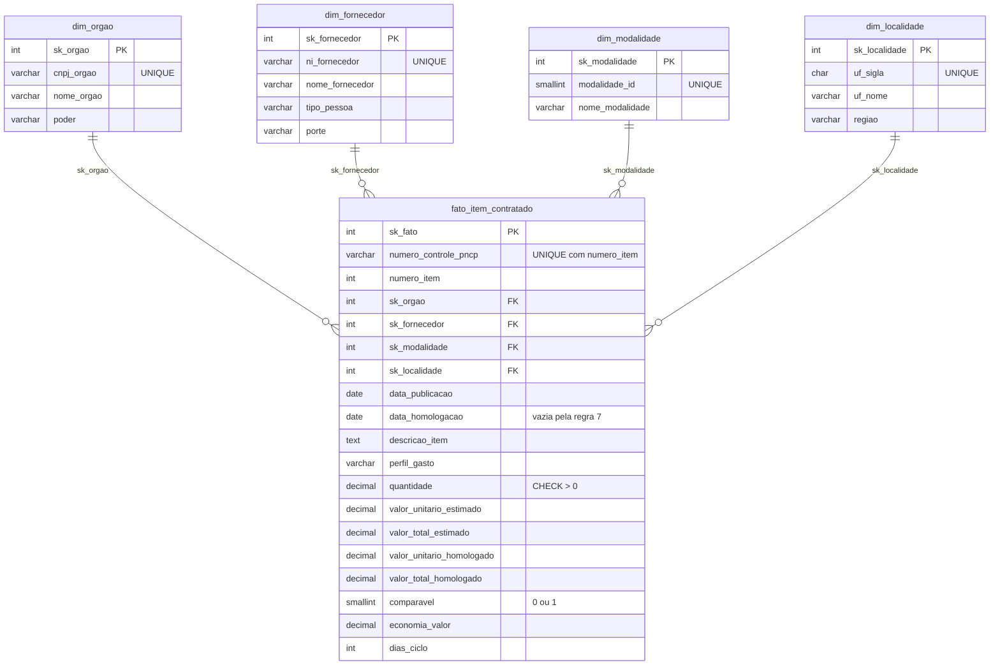

| Tabela | Papel | Linhas |
|---|---|---|
| `fato_item_contratado` | O que foi comprado, por quem, de quem, como e onde | 6.126 |
| `dim_orgao` | Quem comprou (unidade compradora, por CNPJ) | 363 |
| `dim_fornecedor` | Quem vendeu (CNPJ, CPF ou documento estrangeiro) | 2.652 |
| `dim_modalidade` | Como comprou | 7 |
| `dim_localidade` | Onde (UF e região) | 27 |

**Decisões do modelo (`sql/01_criar_banco.sql`):**

- **Chaves substitutas (`sk_`)** em todas as tabelas; as dimensões guardam também a chave natural como `UNIQUE`. A fato não depende de CNPJ ou texto para se ligar às dimensões.
- **Integridade referencial:** toda chave estrangeira da fato aponta para uma linha existente. Cada dimensão tem a linha de exceção **"Não informado" (`sk = -1`)**, fora da sequência 1, 2, 3…, para receber dado ausente. Nesta base, nenhuma chave ficou sem destino.
- **O banco como segunda barreira:**
  - `CHECK` rejeita quantidade ≤ 0, valor negativo e homologação anterior à publicação.
  - `UNIQUE` em `numero_controle_pncp` + `numero_item` impede item duplicado.
  - Valores em `DECIMAL`, nunca `float`.
- **Carga (`src/carregar.py`):** recria o banco, executa o script de criação, carrega as dimensões antes da fato (por causa das chaves estrangeiras), envia cada tabela em lote e faz *rollback* se algo falhar. Ao final, confere as contagens com a prova real.
- **Validação (`sql/03_validacao.sql`):** contagens, chaves sem par (0), itens repetidos (0) e os 12 totais da prova real, todos iguais aos esperados.

## 10. Resultados

### 10.1 Conferência do pipeline Python

A saída de `python -m src.montar_tabelas` bate com todos os totais de conferência do enunciado (anexo 8):

| Indicador | Resultado |
|---|---|
| Itens na fato | 6.126 |
| Contratações distintas | 1.962 |
| Fornecedores | 2.652 |
| Órgãos (CNPJ) | 363 |
| Volume homologado | R$ 8.044.498.805,74 |
| Itens comparáveis | 5.457 |
| Economia | 14,46% |
| Ciclo médio / máximo | 48,1 / 611 dias |
| Itens sem ciclo | 230 |
| Perfil (% do volume homologado) | Obras e engenharia 60,8 · Serviços 36,6 · Bens 2,6 |

A conferência também encontrou um erro durante o desenvolvimento: a regra "valor estimado menor que R$ 1" foi escrita com `<=` e excluía 11 itens válidos (110 rejeitados em vez de 99). Com o operador corrigido para `<`, todos os números bateram.

### 10.2 Respostas às 6 perguntas

Os números vêm das consultas de `sql/02_perguntas.sql` e são os mesmos das medidas do dashboard.

| # | Pergunta | Resposta |
|---|---|---|
| 1 | **Economia:** quanto o governo economizou? | **R$ 992.861.686,95 (14,46%)** nos 5.457 itens comparáveis (89% da base). 27 itens saíram acima do estimado (sobrepreço). |
| 2 | **Fornecedores:** quem concentra o orçamento? | Os **10 maiores fornecedores concentram 41,43%** do volume homologado. O maior, NOW SEGUROS SA, tem 13,18% com um único item de R$ 1,06 bilhão. |
| 3 | **Modalidades:** qual economiza mais e qual movimenta mais? | **Concorrência - Eletrônica** movimenta 58,43% do volume (economia de 14,27%). **Pregão - Eletrônico** tem a maior economia, de **24,02%** (+9,6 p.p. acima da média). Credenciamento (26,6% do volume) não entra na economia, porque não tem disputa de preço. |
| 4 | **Ciclo:** onde as compras demoram mais? | Ciclo médio de **48,1 dias** (máximo de 611). Entre os órgãos com 5 ou mais itens com ciclo, os mais lentos são a **UFCG (266,3 dias)**, o CONFEA (223,0) e o DNIT (156,2). 230 itens ficaram sem ciclo por terem homologação anterior à publicação. |
| 5 | **Regional:** onde se gasta mais e onde há mais desconto? | O **Centro-Oeste concentra 44,25%** do volume (só o DF tem 38,98%, por ser sede dos órgãos federais). O **Norte tem o maior desconto (21,43%)** e o Sul, o menor (7,96%). |
| 6 | **Perfil:** em que o dinheiro é gasto? | **Obras e engenharia: 60,8%** do volume em só 967 itens (16%). Serviços: 36,6%. Bens: 2,6% do volume, mas 3.310 itens (54%). |

## 11. Dashboard

Arquivo: [`powerbi/radar_compras_publicas.pbix`](powerbi/radar_compras_publicas.pbix), também exportado em [PDF](powerbi/radar_compras_publicas.pdf). Os dados vêm do PostgreSQL pelo conector nativo, no modo Importar.

**Modelo no Power BI:**

- **Relacionamentos:** as 4 dimensões ligadas à fato (1:N, filtro em direção única), com as chaves técnicas ocultas.
- **Calendário em DAX:** limites tirados dos dados (`MIN` da publicação e `MAX` da homologação), mês ordenado pelo número e marcado como tabela de datas. A data/hora automática do Power BI foi desligada.
- **Relações do Calendário com a fato:** ativa com `data_publicacao` e inativa com `data_homologacao`. A relação inativa é usada pela medida `Volume por Data de Homologação`, com `USERELATIONSHIP`.

**Medidas:** 21 medidas explícitas na tabela `Medidas`, em pastas por pergunta (P1 a P6 e Extras). Usam:

- `VAR`/`RETURN`;
- `CALCULATE`, `DIVIDE`, `ALL`, `ALLSELECTED`, `REMOVEFILTERS` e `KEEPFILTERS`;
- `TOPN` e `RANKX`;
- `SUMX` como iteradora;
- `USERELATIONSHIP`.

Percentuais são sempre soma ÷ soma. Destaques:

| Medida | O que faz |
|---|---|
| `Economia (R$)` | Estimado comparável − homologado comparável, cada um numa `VAR` |
| `Concentração Top 10 %` | `TOPN` pega os 10 maiores fornecedores; `KEEPFILTERS` soma só o volume deles e divide pelo total com `ALL` |
| `Deságio vs Média Geral (p.p.)` | Economia % da linha − economia % geral (`REMOVEFILTERS`), em pontos percentuais |
| `Ciclo Médio (mín. 5 itens)` | Devolve o ciclo só para órgãos com 5 ou mais itens com ciclo. Assim, o filtro "10 maiores" escolhe entre os órgãos válidos (um filtro de visual separado seria aplicado depois do Top 10) |
| `Itens com Sobrepreço` | `SUMX` percorre os itens comparáveis e conta os que têm homologado > estimado |

**Navegação:**

- **Menu retrátil** em todas as páginas: o botão ☰ abre um painel lateral com um botão para cada página (navegador de página), e o ✕ fecha.
- **Abrir e fechar:** cada página tem dois indicadores (bookmarks), "Menu aberto" e "Menu fechado", que mostram ou ocultam o grupo do menu sem alterar os filtros.
- **Página atual:** fica destacada no menu.
- **Tooltip de página:** a página oculta `Tooltip` aparece ao passar o mouse nos gráficos por **UF** (P5) e por **modalidade** (P3). Ela mostra o volume homologado, a economia %, o total de itens e o ciclo médio do item, com um título dinâmico (medida `Título Tooltip`, com `SELECTEDVALUE` e `COALESCE`).
- **Filtro cruzado:** clicar numa barra filtra os cartões e a tabela da página.

**Páginas:** cada página segue a mesma estrutura: **pergunta (título) → números (cartões e visuais) → conclusão**.

**P1 Economia**
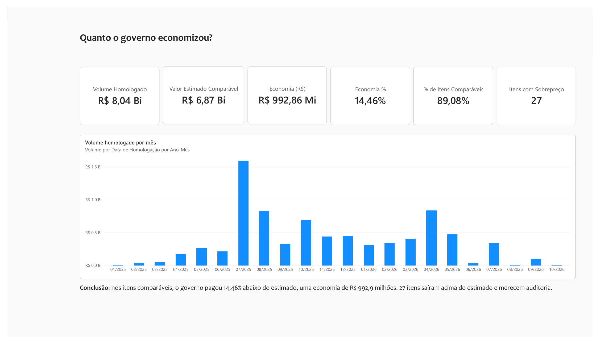

**P2 Fornecedores**
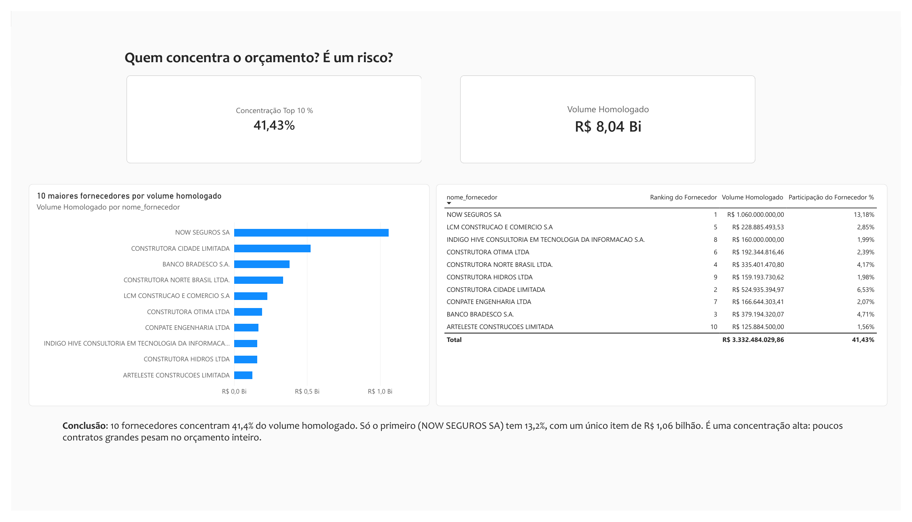

**P3 Modalidades**
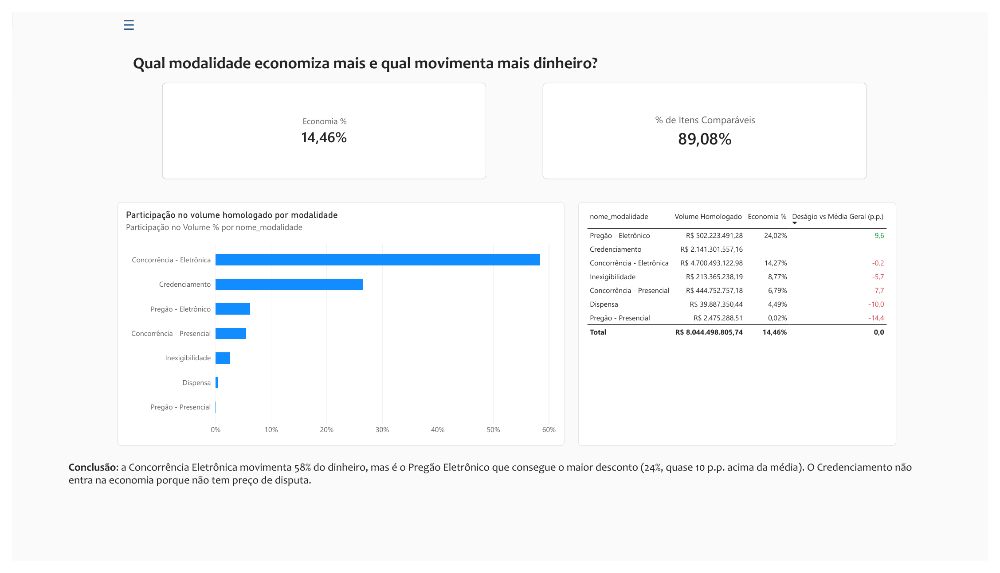

**P4 Ciclo**
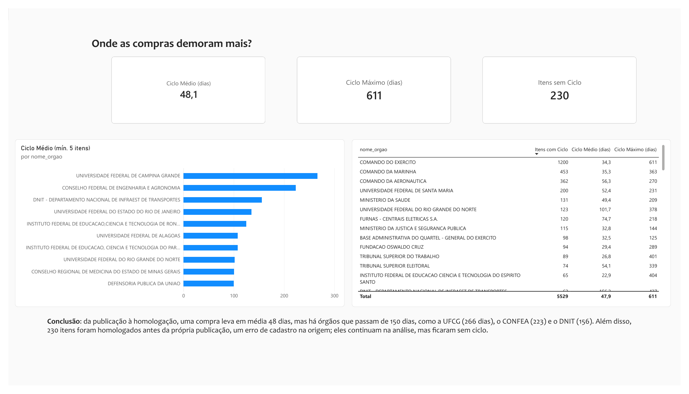

**P5 Regional**
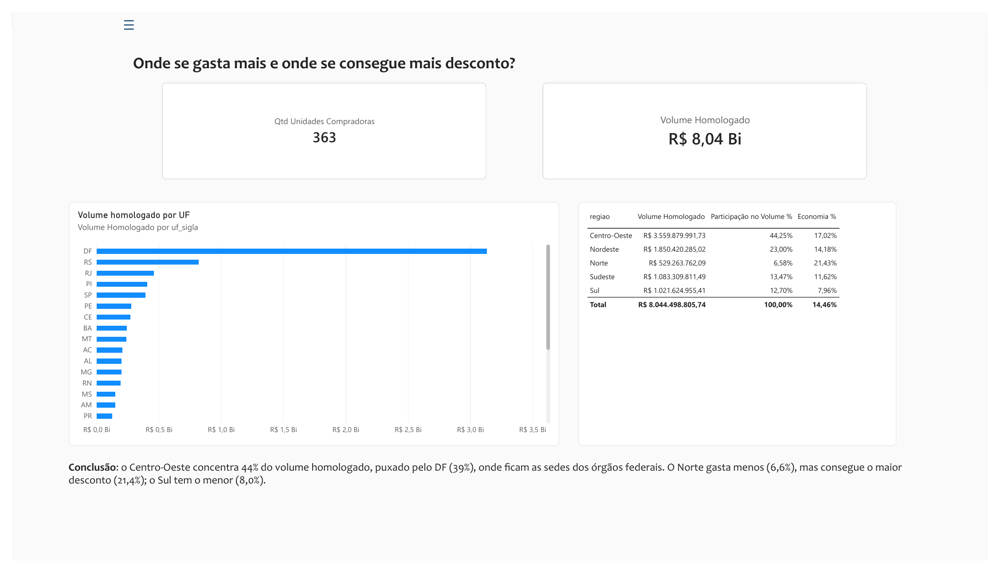

**P6 Perfil**
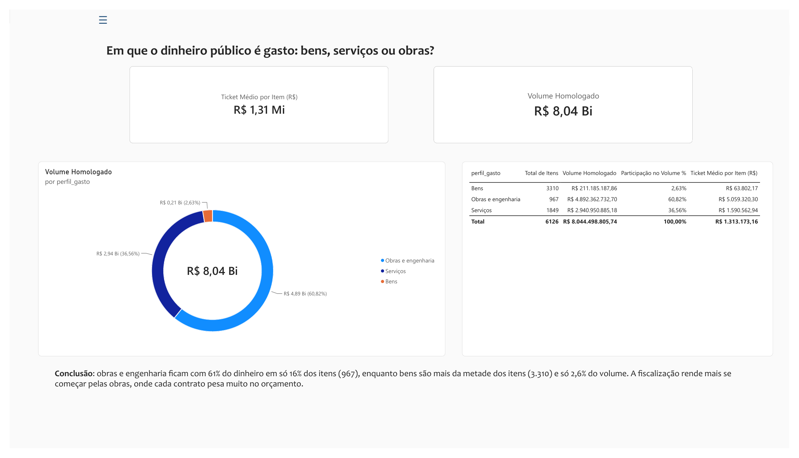

## 12. Como executar

**Pré-requisitos:** Python 3.10+, PostgreSQL e Power BI Desktop.

```bash
git clone https://github.com/karinaperes/Projeto-Final-Avaliativo-Mod2-Analise-Dados.git
cd Projeto-Final-Avaliativo-Mod2-Analise-Dados
python3 -m venv .venv
source .venv/bin/activate        # no Windows: .venv\Scripts\activate
pip install -r requirements.txt
```

**Pipeline Python** (na raiz do projeto, com o `.venv` ativo):

```bash
python -m src.limpeza           # autoteste das funções: 54 de 54
python -m src.montar_tabelas    # gera a fato e as dimensões em data/processed/ e imprime a conferência
```

**Banco PostgreSQL:**

```bash
cp .env.example .env            # preencha usuário e senha do PostgreSQL
python -m src.carregar          # recria o banco, cria as tabelas e carrega em lote
psql -h localhost -U postgres -d pncp_controladoria -f sql/03_validacao.sql   # conferência
psql -h localhost -U postgres -d pncp_controladoria -f sql/02_perguntas.sql   # as 6 perguntas
```

**Dashboard:** abra `powerbi/radar_compras_publicas.pbix` no Power BI Desktop. Para atualizar os dados com o seu banco: **Transformar dados → Configurações da fonte de dados**, troque o servidor e clique em **Atualizar**.

## 13. Planejamento em Sprints

O trabalho foi organizado no GitHub Projects: um milestone por Sprint com data limite, uma issue épica por Sprint e sub-issues para cada tarefa. Cada Sprint tem a sua branch (`sprint-N-...`) e termina com um Pull Request que fecha as issues concluídas.

| Sprint | Objetivo | Período | PR | Situação |
|---|---|---|---|---|
| 0 | Fundação e exploração dos dados | 18–19/10 | #57 | Concluída |
| 1 | Auditoria dos dados | 19–20/10 | #58 | Concluída |
| 2 | Limpeza (`src/limpeza.py`) | 20–29/10 | #59 | Concluída |
| 3 | Montar fato e dimensões | 30/10–06/11 | #60 | Concluída |
| 4 | Banco PostgreSQL | 06–07/11 | #62 | Concluída |
| 5 | Perguntas em SQL | 07/11 | #63 | Concluída |
| 6 | Power BI | 07–12/11 | #64, #66 | Concluída (menu e tooltip feitos após a extensão do prazo) |
| 7 | Documentação e entrega | 09/11 | #64 | README, diagrama e figura das Sprints concluídos |

**Replanejamento.** O plano inicial previa a entrega em 02/11. As Sprints 2 e 3 levaram mais tempo que o estimado e o prazo foi estendido em uma semana; as datas das Sprints 2 a 7 foram reajustadas no GitHub Projects (comparar os prints de início, andamento e entrega abaixo). A Sprint 6 (Power BI) foi feita numa máquina virtual com Windows dentro do Fedora, porque o Power BI Desktop só roda no Windows. Com uma nova extensão do prazo até 16/11, o menu retrátil e a página de tooltip, que tinham ficado pendentes na Sprint 6, foram concluídos.

**Figura final das Sprints:**


### Evolução do quadro

**Planejamento inicial (18/10)**


**Andamento: após a Sprint 3 (06/11)**

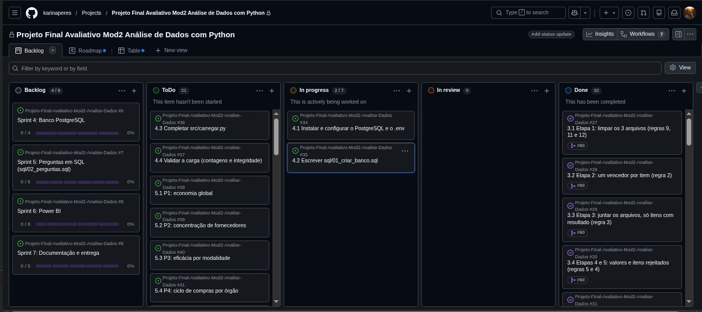
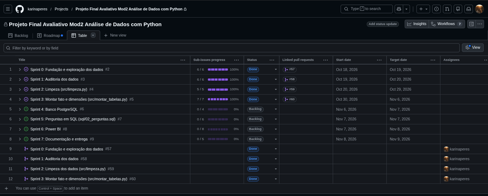

**Entrega final (09/11)**

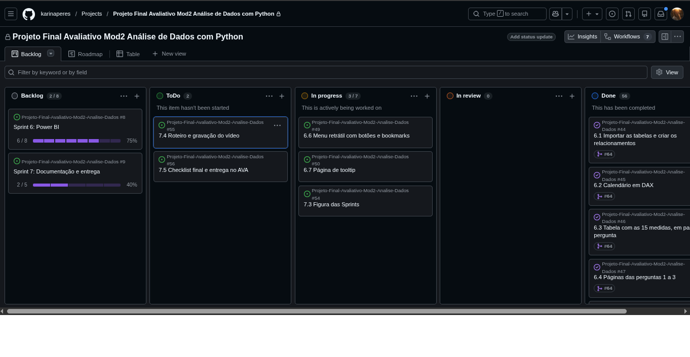
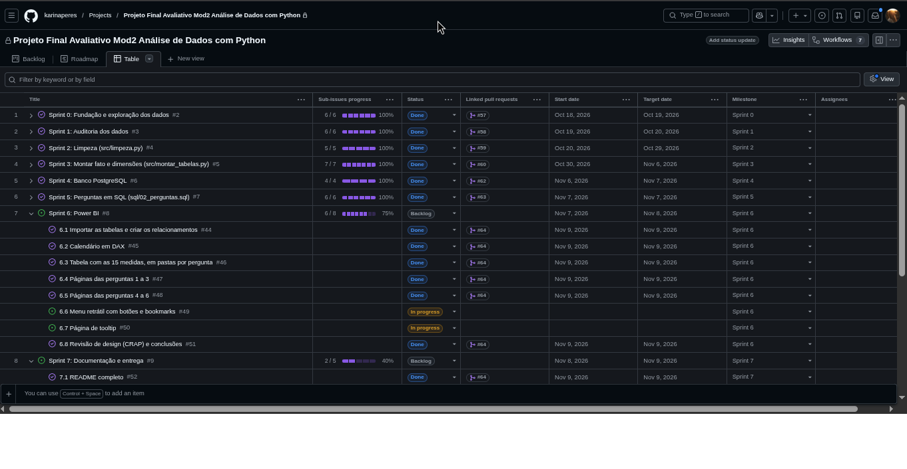
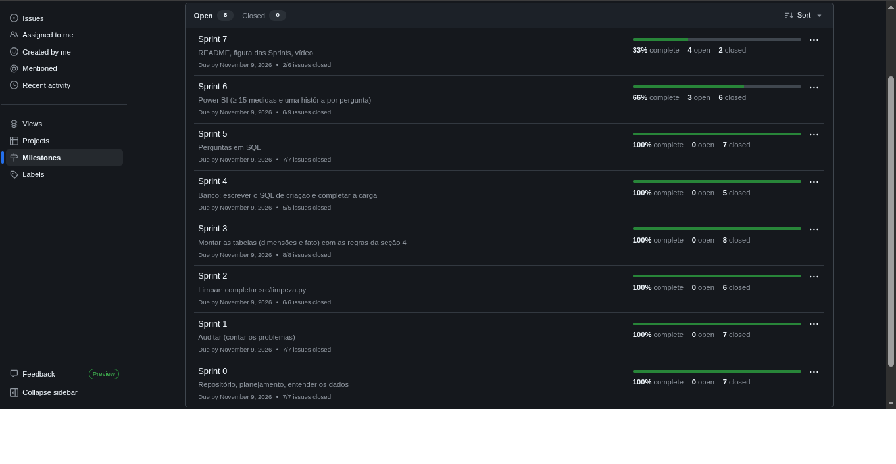

## 14. Melhorias futuras

- **Tooltip em mais visuais:** estender a página de tooltip aos gráficos de fornecedores, órgãos e perfil.
- **Padronização de nomes de órgãos:** variações como "EDUCACAO,CIENCIA" e "EDUCACAO, CIENCIA" ainda aparecem como órgãos diferentes. Uma tabela de equivalência por raiz do CNPJ resolveria.
- **Documentos estrangeiros (PE):** remover pontuação também nesses documentos, para unificar casos como `ES.TRA.NG0/0024-21` e `ESTRANG0002421`.
- **Validação na origem:** as 230 homologações anteriores à publicação e os 99 itens rejeitados mostram que o sistema de origem aceita dados impossíveis. Regras de validação na entrada evitariam o retrabalho.
- **Atualização automática:** consumir a API do PNCP e agendar o pipeline (extração, limpeza e carga) para manter o dashboard atualizado.
- **Testes automatizados:** transformar o autoteste de `src/limpeza.py` e a conferência da prova real em testes com `pytest`.

**Lições aprendidas:**

- **Conferir com a prova real**, e não só ver se o código roda. Foi assim que apareceu o erro do `<=`, que excluía 11 itens válidos.
- **Ambiente reprodutível:** uma atualização do sistema operacional trocou a versão do Python e quebrou o `.venv`. O `requirements.txt` permitiu recriá-lo em minutos.
- **Replanejar:** as Sprints 2 e 3 levaram mais tempo que o estimado, e o cronograma foi refeito no GitHub Projects (seção 13).

## 15. Vídeo

Apresentação do projeto no formato de Review de Sprint (até 7 minutos):

**[Assistir no YouTube](https://youtu.be/mQOzK9vNYWg)**

## 16. Autoria

Karina Peres · [GitHub](https://github.com/karinaperes)
